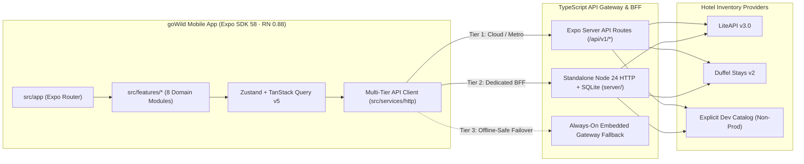

<div align="center">
  <picture>
    <source media="(prefers-color-scheme: dark)" srcset="assets/brand/gowild-logo-dark.png" />
    <source media="(prefers-color-scheme: light)" srcset="assets/brand/gowild-logo-light.png" />
    
  </picture>

  <h3>Worldwide Hotel Discovery, Live Rate Revalidation &amp; Reservations</h3>

  <p>
    A production-oriented cross-platform travel &amp; hospitality mobile application built with <strong>Expo SDK 58</strong>, <strong>React Native 0.88</strong>, <strong>React 19.3</strong>, strict <strong>TypeScript 6.0</strong>, and a multi-tier <strong>TypeScript API Gateway &amp; BFF</strong>.
  </p>

  <p>
    
    
    
    
    
  </p>
</div>

---

## Overview

**goWild** is a cross-platform mobile hotel discovery, geospatial exploration, comparison, availability pricing, and reservation application for iOS and Android.

Unlike static travel UI prototypes, **goWild** implements an end-to-end hospitality booking architecture:
- **Complete Reservation Journey**: Welcome Start Screen → Home Discovery → Destination Autocomplete, Dates &amp; Guest Occupancy → Filtered &amp; Sorted Search Results → Interactive Pinch-to-Zoom Street Map → Hotel Details, Lightbox Photo Gallery, Facilities, Policies &amp; Reviews → Room Rate Selection → Live Pre-Checkout Offer Revalidation &amp; Itemized Tax/Fee Breakdown → Idempotent Reservation Creation → Confirmation Receipt → **My Trips** Management &amp; Cancellation.
- **Provider-Neutral Supplier Layer**: Clean `HotelProvider` domain contracts supporting **LiteAPI v3.0** (live global hotel inventory, prebook quote revalidation, sandbox &amp; hosted checkout), **Duffel Stays v2** (live search, quote locking, booking &amp; cancellation), and an isolated **Development Catalog** for zero-key evaluation.
- **Zero Client Secrets**: Supplier API keys (`LITEAPI_KEY`, `DUFFEL_ACCESS_TOKEN`), user password hashes (`scrypt`), session tokens, revalidated price quotes, and idempotent booking records never enter the mobile bundle or `EXPO_PUBLIC_*` variables.
- **Always-Reachable Multi-Tier API Gateway**: Automatically routes through Cloud / Expo Server API Routes (`/api/v1/*`), standalone Node 24 + SQLite BFF (`server/`), or an `AsyncStorage`-persisted embedded gateway so discovery, maps, favorites, and reservations remain functional in every environment.

---

## Key Features

### 1. Discovery, Search &amp; Filtering
- **Full-Bleed Branded Start Screen**: Edge-to-edge photography with the centered **goWild** geometric flower mark (`#40B4F8`) and one-tap entry.
- **Home Discovery**: Centered brand header, quick search trigger, check-in/check-out &amp; guest chips, interactive map callout, destination pills (*Paris, Tokyo, Marrakech, Santorini, New York, Dubai*), recent searches, **Popular** stays carousel, and category-filtered **Recommended** stays (*Hotels, Resorts, Villas, Boutique, Apartments*).
- **Autocomplete &amp; Occupancy**: Debounced city/landmark search, custom calendar date range picker, room counter, adult counter, and child count/age configuration.
- **Multi-Faceted Filters &amp; Sorting**: Sort by *Recommended*, *Lowest Price*, *Highest Rated*, or *Luxury First*; filter by nightly price range, star rating, property type, amenities, free cancellation, and instant confirmation.

### 2. Interactive Street Map Discovery
- **Web-Mercator Slippy Street Map**: Live OpenStreetMap street tiles paired with offline vector grid fallback.
- **Two-Finger Pinch-to-Zoom &amp; Smooth Pan**: Continuous floating-point zoom (`z2` worldwide to `z16` street level) with fractional tile scaling and midpoint tracking.
- **Direct Map-to-Hotel Navigation**:
  - Tap any circular hotel photo/price pin to open that hotel's detail &amp; room offers screen (`/hotel/[id]`).
  - Tap any area or point inside the map to jump directly to available hotels for that region (`/search`).
  - Synchronized horizontal hotel preview cards along the bottom edge + quick-jump city pills + native Apple Maps / Google Maps deep-link launcher.

### 3. Hotel Details, Live Room Offers &amp; Booking Lifecycle
- **Photography-First Presentation**: Pure, un-obscured hotel imagery with full-screen lightbox gallery, star class, verified guest review summaries, amenities, check-in/out windows, and cancellation policies.
- **Room &amp; Rate Comparison**: Board types (*Room Only, Breakfast Included, Half Board, All Inclusive*), bed configurations, room area (`m²`), scarcity indicators, and refundable vs. non-refundable rate plans.
- **Mandatory Pre-Checkout Revalidation**: Calls `POST /api/v1/offers/revalidate` immediately before booking to verify live availability, lock a quote (`quoteId` with expiration), and surface any supplier price changes transparently.
- **PCI-Safe Idempotent Checkout**: Validated lead traveler form (`react-hook-form` + `zod`) with itemized room subtotal, municipal/occupancy taxes, and property fees. Reservations use an `Idempotency-Key` header to prevent duplicate bookings and never collect raw card numbers in custom forms.
- **My Trips &amp; Cancellations**: Segmented **Upcoming**, **Completed**, and **Cancelled** views with full confirmation receipts, supplier references, and verified cancellation workflow.

### 4. Account, Personalization &amp; Cross-Platform Polish
- **Traveler Authentication &amp; Sync**: Sign up, sign in, session persistence, profile editing, and server-synced favorites &amp; bookings.
- **Multi-Currency &amp; Bilingual UI**: Instant switching across `USD`, `EUR`, `GBP`, `MAD`, and `JPY`, plus English (`en`) and French (`fr`) interface localization.
- **Native Platform Navigation**:
  - **iOS**: Native Apple `UITabBarController` via `expo-router/native-tabs` (`GoWildTabs.ios.tsx`) with SF Symbols.
  - **Android**: Custom floating `GoWildGlassTabBar` (`GoWildTabs.android.tsx`) built with `expo-router/js-tabs`, `expo-blur`, and `react-native-reanimated`.
- **Accessibility &amp; Appearance**: Light and Dark (`#0E121B` charcoal midnight) themes, `reducedMotion` toggle, semantic accessibility roles/labels, and `44pt+` touch targets.

---

## System Architecture



### Repository Structure

```text
goWild/
├── assets/
│   ├── goWild (1080 x 600 px).png     # Canonical brand source of truth
│   └── brand/                         # Transparent light, dark & mark variants
├── src/
│   ├── app/                           # Thin Expo Router screens + /api/[...route]+api.ts
│   ├── components/
│   │   ├── navigation/                # GoWildTabs.ios.tsx & GoWildTabs.android.tsx
│   │   └── ui/                        # BrandLogo, GlassSurface, SearchBar, PriceDisplay...
│   ├── features/
│   │   ├── hotels/                    # Onboarding, Home, Search, Detail, HotelCard, Gallery
│   │   ├── availability/              # DateRangePicker, GuestCounter, RoomOfferCard, Pricing
│   │   ├── bookings/                  # BookingReview, Confirmation, MyTrips, SummaryCard
│   │   ├── maps/                      # MapDiscoveryScreen & InteractiveHotelMap (pinch/tap)
│   │   ├── favorites/                 # Saved stays screen & sync
│   │   ├── auth/                      # Sign-In, Sign-Up & session hooks
│   │   ├── profile/                   # Traveler settings, currency, language, appearance
│   │   └── notifications/             # Notification center & read-state mutations
│   ├── services/
│   │   ├── gateway/                   # Always-on embedded local gateway ledger
│   │   ├── http/                      # Auto-discovering typed API client & error taxonomy
│   │   └── providers/                 # Provider-neutral contracts
│   ├── stores/                        # Zustand persisted stores (search, auth, favorites, UI)
│   ├── theme/                         # Design tokens, typography, motion, light/dark palettes
│   ├── types/                         # Provider-independent domain contracts
│   └── lib/                           # Config, Zod v4 schemas, currency & haversine math
├── server/
│   └── src/                           # Node 24 HTTP + SQLite BFF, auth, & supplier adapters
│       └── providers/                 # liteApiProvider.ts, duffelStaysProvider.ts, devFixtureProvider.ts
├── tests/                             # Node --test unit, provider, BFF & gateway integration suite
├── README/                            # Deep-dive setup, demo, Figma audit & provider docs
└── .agents/                           # Engineering architecture, API contracts & decision logs
```

---

## Tech Stack

| Layer | Technology |
| :--- | :--- |
| **Mobile Framework** | Expo SDK `~58.0.19`, React Native `0.88.0`, React `19.3.0` (React Compiler enabled) |
| **Routing &amp; Navigation** | `expo-router` v55 (Typed Routes, `native-tabs` on iOS, `js-tabs` on Android, Server API Routes) |
| **Language &amp; Validation** | TypeScript `~6.0.3` (`strict: true`, zero `any`), `zod` `^4.3.6` |
| **State &amp; Data Fetching** | `@tanstack/react-query` `^5.99.0`, `zustand` `^5.0.12`, `@react-native-async-storage/async-storage` |
| **Forms** | `react-hook-form` `^7.72.1` + custom Zod v4 resolver |
| **Styling &amp; Motion** | NativeWind v4 (`^4.2.3`), `react-native-reanimated` `4.7.1`, `expo-blur`, `expo-image`, `react-native-svg` |
| **Icons** | `lucide-react-native` (cross-platform UI) + Apple SF Symbols (iOS native tab bar only) |
| **Backend / API Gateway** | Node 24 native TypeScript (`node:http`, `node:sqlite`, `node:crypto`), Web Fetch `Request`/`Response` gateway |

---

## Quick Start

### Prerequisites
- **Node.js `>= 24.0.0`** (uses native TypeScript execution &amp; built-in `node:sqlite`)
- **npm `>= 10`**
- **iOS Simulator** (Xcode on macOS), **Android Emulator** (Android Studio), or **Expo Go** on a physical device

### 1. Install Dependencies

```bash
git clone https://github.com/AyoubAmeur-crypto/GoWild.git
cd GoWild
npm install
```

### 2. Configure Environment (Optional for Live Supplier Keys)

```bash
cp .env.example .env
```

By default, `.env.example` runs with `GOWILD_PROVIDER=development_fixtures` so you can explore the complete discovery, map, revalidation, and booking lifecycle immediately without external credentials.

To connect live hotel inventory, set one of the following in `.env` (server-side only):

| Variable | Description | Default |
| :--- | :--- | :--- |
| `GOWILD_PROVIDER` | `liteapi` \| `duffel` \| `development_fixtures` | `development_fixtures` |
| `LITEAPI_KEY` | LiteAPI v3.0 sandbox (`sand_...`) or live secret key | *(unset)* |
| `DUFFEL_ACCESS_TOKEN` | Duffel Stays v2 test (`duffel_test_...`) or live token | *(unset)* |
| `BFF_PORT` | Port for standalone Node 24 BFF server | `4010` |
| `EXPO_PUBLIC_API_BASE_URL` | Optional cloud API Gateway URL override for mobile client | Auto-discovered |

> **Security Rule**: Never place `LITEAPI_KEY` or `DUFFEL_ACCESS_TOKEN` inside `EXPO_PUBLIC_*`. When `liteapi` or `duffel` is selected and credentials are missing or an upstream error occurs, the gateway returns explicit typed errors (`PROVIDER_NOT_CONFIGURED` / `UPSTREAM_PROVIDER_ERROR`) and never silently substitutes mock data.

### 3. Run the App

**Option A — Single-Command Zero-Config Mode** (uses Expo's built-in `/api/v1/*` API Gateway + automatic local failover):

```bash
npx expo start -c
```

**Option B — Dedicated Node 24 + SQLite BFF Server + Expo**:

```bash
# Terminal 1: Start the persistent SQLite BFF on http://localhost:4010
npm run server

# Terminal 2: Start Expo Metro bundler
npx expo start -c
```

Press **`i`** for iOS Simulator, **`a`** for Android Emulator, or scan the QR code on your phone (`npx expo start --tunnel` is also supported out of the box).

---

## Cloud API Gateway Deployment

Because `src/app/api/[...route]+api.ts` compiles into an Expo Server API bundle (`eas.json` configured with `"web": { "output": "server" }`), you can deploy a permanent HTTPS API Gateway in one command:

```bash
npx expo export --platform web
npx eas deploy --prod
```

---

## Testing &amp; Verification

Run the full engineering verification gate at any time:

```bash
# 1. Strict TypeScript verification (mobile client + BFF server + tests)
npm run typecheck

# 2. Automated unit, provider adapter, BFF lifecycle & API gateway integration tests
npm test

# 3. Production iOS & Android bundle compilation checks
HOME=/tmp EXPO_NO_TELEMETRY=1 npx expo export --platform ios --output-dir /tmp/gowild-ios-check
HOME=/tmp EXPO_NO_TELEMETRY=1 npx expo export --platform android --output-dir /tmp/gowild-android-check
```

---

## Documentation

- **[Setup &amp; Environment Guide](README/SETUP.md)** — Detailed local, physical-device LAN/tunnel, live supplier, and cloud gateway instructions.
- **[End-to-End Demo Walkthrough](README/DEMO.md)** — Step-by-step tour of discovery, map gestures, offer revalidation, checkout, and cancellation.
- **[Hotel API Provider Evaluation](README/API_PROVIDER_EVALUATION.md)** — Architectural comparison of LiteAPI, Duffel Stays, Amadeus, Expedia Rapid, and Booking.com Demand API.
- **[Figma Design Audit](README/FIGMA_AUDIT.md)** — Token and component mapping adapted for the **goWild** brand identity.
- **[Engineering Rules (`AGENTS.md`)](AGENTS.md)** &amp; **[`.agents/` Architecture Docs](.agents/README.md)** — Domain contracts, API specifications, design system tokens, and ADRs.

---

## License

Released under the [MIT License](LICENSE).
